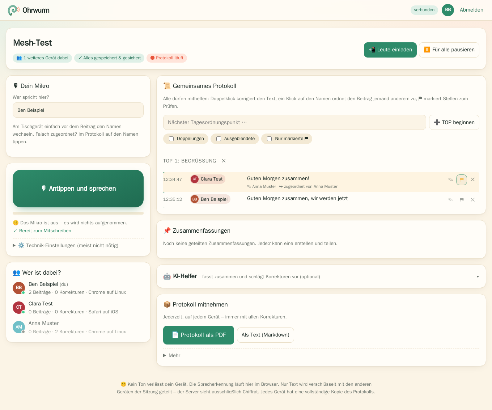
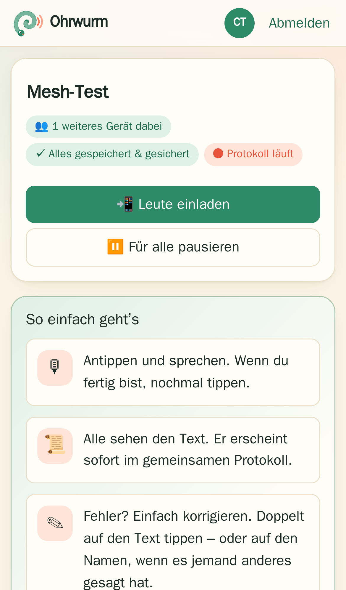
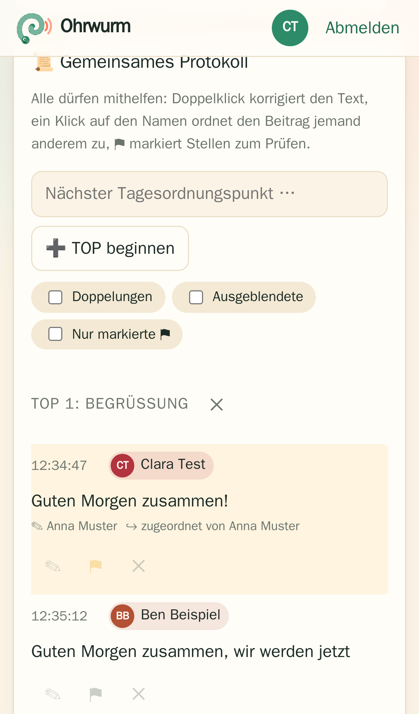
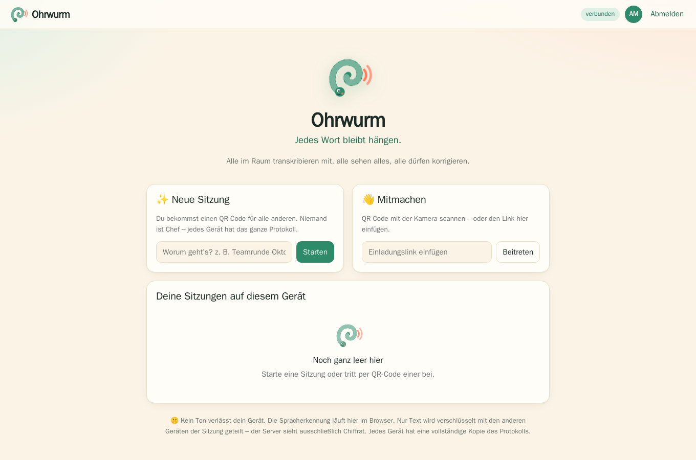
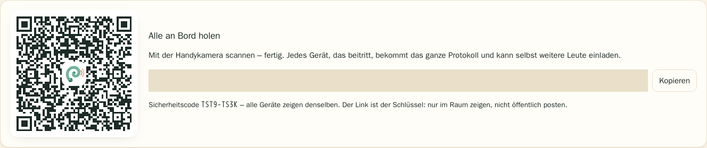

<p align="center"></p>

<h1 align="center">Ohrwurm</h1>
<p align="center"><strong>Jedes Wort bleibt hängen.</strong><br>Gemeinsames Gesprächsprotokoll: Alle im Raum schreiben mit, alle sehen alles, alle dürfen korrigieren.</p>

- **Kein Ton verlässt das Gerät.** Whisper läuft im Browser (WebGPU oder WASM), geteilt wird nur der erkannte Text.
- **Client-Client-Mesh statt Host.** Jedes Gerät hält eine vollständige Kopie des Protokolls und gleicht sie mit allen anderen ab. Fällt ein Gerät aus, auch das, das die Sitzung gestartet hat, läuft alles weiter.
- **Schwarmintelligenz.** Alle können Text korrigieren, Beiträge einer anderen Person zuordnen, Stellen ⚑ markieren, ausblenden und Tagesordnungspunkte setzen. Jede Änderung ist signiert und nachvollziehbar.
- **Eigener KI-Helfer.** Jede:r kann ein lokales LLM oder einen Firmen-Endpunkt (OpenAI-kompatibel) auf das Protokoll ansetzen, um es zusammenzufassen oder Korrekturen vorschlagen zu lassen. Die Ergebnisse bleiben privat, bis man sie teilt.
- **PDF auf Knopfdruck.** Das Protokoll wird direkt im Browser als PDF erzeugt (jsPDF), zusätzlich gibt es Markdown und das signierte Rohdaten-JSON.
- **Für alle gemacht.** Große Knöpfe, einfache Sprache, eine Drei-Schritte-Anleitung. Die Technik steckt in aufklappbaren Bereichen.
- **Der Server ist nur Briefträger.** Er sieht ausschließlich Chiffrat und speichert nichts.

```
   Gerät A ─┐                                    ┌─ Gerät C
 (Laptop)   │   verschlüsselte, signierte Ops    │  (Handy)
            ├──────────►  Relay (Go)  ◄──────────┤
   Gerät B ─┘   live an alle + gezielter Abgleich └─ Gerät D …
  (Tisch)       "want/ops" von Gerät zu Gerät
  Jedes Gerät: Mikro → Whisper → signierte Op → IndexedDB (vollständige Kopie)
```

## So sieht’s aus

| Gemeinsame Sitzung am Laptop | Auf dem Handy |
|---|---|
|  |   |

| Start | Einladen per QR-Code |
|---|---|
|  |  |

Beispiel-Export: [docs/beispiel-protokoll.pdf](docs/beispiel-protokoll.pdf). Er wird direkt im Browser mit jsPDF erzeugt.

Die Bilder stammen aus dem automatischen Browser-Test (`make e2e-lan && make docs`) und lassen sich so jederzeit aktualisieren.

## Schnellstart

Voraussetzung auf dem Host: **Docker** (inkl. `docker compose`) und `make`. Alles andere läuft in Containern.

```sh
make models     # Whisper-Modelle (base, small) nach ./models laden, einmalig
make run        # bauen und mit Dev-Anmeldung starten → https://localhost:8443
make run-oidc   # stattdessen mit Dex als OIDC-Provider (anna@example.com / password)
make stop
```

Das Dev-Zertifikat ist selbstsigniert und muss im Browser einmal akzeptiert werden. HTTPS ist Pflicht, weil Browser das Mikrofon nur in sicheren Kontexten freigeben.

### Test im lokalen Netz mit Dex und Dummy-Konten

```sh
make run-lan                          # LAN-IP wird automatisch ermittelt
make run-lan LAN_HOST=192.168.1.20    # oder explizit (IP oder Hostname)
make stop-lan
```

Caddy terminiert TLS und stellt Relay und Dex unter **einem** Origin bereit: `https://<LAN_HOST>:8443`, Dex unter `/dex`. Deshalb muss jedes Gerät das selbstsignierte Zertifikat nur einmal akzeptieren. Danach funktionieren Mikrofon, Anmeldung und WebSocket.

| Konto | Passwort |
|---|---|
| `moderation@example.com`, `anna@…`, `ben@…`, `clara@…`, `david@…`, `emma@…`, `tisch1@…`, `tisch2@example.com` | `password` |

Ein typischer Testablauf:
1. Am Laptop als `moderation@example.com` anmelden und eine Sitzung starten.
2. Den QR-Code mit den Handys scannen und dort mit anderen Konten anmelden.
3. Auf den Handys „Antippen und sprechen“ nutzen. Der Text erscheint bei allen, und alle können korrigieren.
4. Zum Testen der Ausfallsicherheit: den Laptop schließen. Die Handys arbeiten weiter, und ein neu beitretendes Gerät bekommt alles von ihnen.

Hinweise:
- **Firewall:** Port 8443 muss im LAN erreichbar sein.
- **Ollama auf dem eigenen Laptop:** Ollama mit `OLLAMA_ORIGINS=https://<LAN_HOST>:8443` starten.
- **Zertifikat:** Ändert sich die LAN-IP, erzeugt `make run-lan` das Zertifikat automatisch neu.

### Automatischer Browser-Test

```sh
make run && make e2e      # drei Chromium-Geräte, Fake-Mikrofon, Ausfall eines Geräts, PDF-Export
make run-lan && make e2e-lan   # dasselbe inkl. Dex-Login; Screenshots und PDF landen in e2e/out/
```

## Make-Ziele

| Ziel | Zweck |
|---|---|
| `make bootstrap` | Lockfiles (`package-lock.json`, `go.sum`) im Container erzeugen. Nur nach Änderungen an Abhängigkeiten, Ergebnis committen |
| `make check` | TypeScript-Typprüfung, `go vet` und `go test` |
| `make image` | Laufzeit-Image `ohrwurm:dev` (scratch, statisches Binary mit eingebettetem Client) |
| `make build` | `check` und `image` |
| `make dist` | Statisches Binary nach `dist/ohrwurm-relay` |
| `make models` | Modelle laden (`MODELS="onnx-community/whisper-small …"`) |
| `make certs` | Dev-Zertifikat (`SAN=…`) |
| `make run` / `run-oidc` / `stop` / `logs` | Betrieb über `compose.yaml` |
| `make run-lan` / `stop-lan` / `logs-lan` | LAN-Test mit Dex und Caddy (`compose.lan.yaml`) |
| `make e2e` / `e2e-lan` | Browser-Test mit drei Geräten (lokal bzw. im LAN mit Dex) |
| `make docs` | Screenshots und Beispiel-PDF aus dem letzten E2E-Lauf nach `docs/` übernehmen |

Die Pipeline ist komplett im [Dockerfile](Dockerfile) definiert: `client-deps → client-check/client-build → relay-deps → relay-test/relay-build → runtime`.

Das Ergebnis ist **ein einziges statisches Binary**: Der gebaute Client wird per `go:embed` eingebettet. Das Image (`FROM scratch`) enthält nur dieses Binary und die CA-Zertifikate. Die Whisper-Modelle sind bewusst nicht enthalten, weil sie mehrere hundert MB groß sind. Sie werden als Volume nach `/models` eingebunden.

### GitHub Actions

[`.github/workflows/ci.yml`](.github/workflows/ci.yml) nutzt dieselben Dockerfile-Stufen wie `make`:

- **Pull Request:** prüfen (`client-check`, `relay-test`) und das Image bauen, ohne es zu veröffentlichen.
- **Push auf `main`:** zusätzlich das Image nach `ghcr.io/tna76874/ohrwurm:main` und `:latest` pushen, für amd64 und arm64.
- **Tag `v1.2.3`:** Image mit den Tags `1.2.3` und `1.2` sowie ein GitHub-Release mit den Binaries `ohrwurm-relay-linux-{amd64,arm64}` und `SHA256SUMS`.

## Konfiguration (Relay)

| Variable | Standard | Bedeutung |
|---|---|---|
| `OHRWURM_ADDR` | `:8443` | Listen-Adresse |
| `OHRWURM_TLS_CERT` / `OHRWURM_TLS_KEY` | – | TLS. Ohne diese Variablen läuft HTTP (dann nur hinter TLS-Proxy oder auf localhost sinnvoll) |
| `OHRWURM_AUTH` | `oidc` | `oidc` oder `dev` (nur Tests: freie Namenswahl) |
| `OHRWURM_OIDC_ISSUER` | – | Issuer-URL, so wie der Browser sie sieht |
| `OHRWURM_OIDC_INTERNAL_URL` | – | optional: Adresse, unter der der Relay den IdP erreicht (z. B. im Docker-Netz) |
| `OHRWURM_OIDC_CLIENT_ID` | – | öffentlicher Client mit PKCE, Redirect-URI `https://<host>/` |
| `OHRWURM_OIDC_SCOPES` | `openid profile email` | bei Dex `offline_access` ergänzen, damit Refresh-Tokens ausgegeben werden |
| `OHRWURM_LLM_ORIGINS` | Ollama (`:11434`) und LM Studio (`:1234`) auf `localhost`/`127.0.0.1` | Origins, die der Browser für KI-Aufrufe nutzen darf. Wird als CSP `connect-src` erzwungen. Mit `make run-lan OHRWURM_LLM_ORIGINS="…"` überschreibbar |
| `OHRWURM_MODELS_DIR` | `/models` | Verzeichnis mit `<org>/<modell>/…` |
| `OHRWURM_SESSION_TTL` | `24h` | Sessions ohne Aktivität werden danach verworfen |

**Authentik (Produktion):** Lege einen OAuth2/OpenID-Provider mit dem Client-Typ *public* an, Redirect-URI `https://<host>/`. Dann setzt du:
- `OHRWURM_OIDC_ISSUER=https://auth.example.org/application/o/<slug>/`
- `OHRWURM_OIDC_CLIENT_ID=<client-id>`
- `OHRWURM_OIDC_SCOPES="openid profile email offline_access"`

**Produktivbetrieb hinter Traefik mit externem IdP (Authentik, Keycloak, Entra ID):** siehe [deploy/traefik/](deploy/traefik/README.md). Dort liegen eine Compose-Datei mit allen Labels, eine `.env.example` und eine Anleitung.

**Lokales KI-Modell:**
- **LM Studio:** Im Server-Tab den Server starten und **„Enable CORS“** einschalten. Im KI-Helfer `localhost:1234` eintragen, `/v1` wird automatisch ergänzt.
- **Ollama:** mit `OLLAMA_ORIGINS=https://<ohrwurm-host>` starten und `localhost:11434` eintragen.
- **Chrome** fragt beim ersten Zugriff auf `localhost` ggf. nach der Berechtigung für lokale Geräte. Diese bitte erlauben.
- **Endpunkt im Firmennetz:** Der Endpunkt muss HTTPS sprechen (sonst blockiert der Browser Mixed Content) und in `OHRWURM_LLM_ORIGINS` stehen.

## Wie das Mesh funktioniert

- **Op-Log.** Alles ist eine signierte Operation (Op):
  - Beitrag
  - Textkorrektur
  - Sprecherzuordnung
  - Markierung
  - Ausblenden
  - Tagesordnungspunkt
  - Titel
  - Pause
  - geteilte Zusammenfassung

  Jede Op trägt Autor, Sequenznummer und Lamport-Uhr. Alle Geräte berechnen daraus deterministisch dieselbe Ansicht. Bei gleichzeitigen Änderungen gewinnt die spätere (Last-Writer-Wins), und die Historie bleibt erhalten.
- **Abgleich.**
  - Neue Ops gehen live an alle.
  - Beim (Wieder-)Beitritt sendet ein Gerät seinen Stand (`hello`). Wer mehr hat, antwortet mit seinem Stand. Fehlendes wird gezielt per `want` bei einem Gerät angefordert, das es hat, bevorzugt beim Autor selbst.
  - Ein periodischer Abgleich und die Erkennung von Lücken fangen Verluste ab.
- **Robustheit.**
  - Jedes Gerät speichert die vollständige Kopie in IndexedDB.
  - Startet der Relay neu, legt der erste wiederkehrende Client die Sitzung neu an. Die Session-ID wählen die Clients selbst, und die Geräte synchronisieren sich gegenseitig.
  - Die Anzeige „Alles gespeichert & gesichert“ erscheint, sobald mindestens ein anderes Gerät nachweislich alles hat.

## Sicherheitsmodell

1. **Gruppenschlüssel.**
   - Der Einladungslink bzw. QR-Code enthält im URL-Fragment die Session-ID und einen zufälligen AES-256-GCM-Schlüssel. Das Fragment wird nie an den Server gesendet.
   - Die App entfernt den Schlüssel nach dem Öffnen aus der Adresszeile.
   - Alle Geräte zeigen denselben Sicherheitscode.
   - Wer den Link hat, ist dabei. Also nur im Raum zeigen.
2. **Signaturen.**
   - Jedes Gerät hat ein eigenes ECDSA-P-256-Schlüsselpaar. Der private Schlüssel ist nicht exportierbar.
   - Die Peer-ID ist der Hash des öffentlichen Schlüssels.
   - Ops ohne gültige Signatur werden verworfen. Keiner kann Beiträge oder Korrekturen im Namen anderer erzeugen, auch nicht beim Weiterleiten durch Dritte.
3. **Identität.**
   - Der Relay prüft das OIDC-ID-Token und bindet die Peer-ID an die angemeldete Person.
   - Die Geräte merken sich die erste Bestätigung je Peer und warnen bei Widersprüchen.
   - ID-Tokens werden bewusst *nicht* an andere Geräte verteilt, weil das Bearer-Tokens wären.
4. **Relay-Härtung.**
   - Es werden nur Text-Frames angenommen. Binärframes, also z. B. Audio, führen zum Verbindungsabbruch.
   - `data` muss base64url sein.
   - Rate-Limit und Größenlimits greifen.
   - Peer-IDs sind an die angemeldete Person gebunden.
   - Die CSP erlaubt Verbindungen nur zum eigenen Server, zum IdP und zu den freigegebenen LLM-Origins.

**Was der Relay sieht:**
- wer wann einer Session beitritt (Name aus OIDC),
- Zeitpunkt und Größe verschlüsselter Nachrichten.

Inhalte sieht er nicht, und er speichert nichts.

## Grenzen

- Qualität der Spracherkennung: Whisper base und small sind auf Deutsch brauchbar, aber nicht perfekt. Mit WebGPU ist `small` auf Laptops gut nutzbar, Handys schaffen eher `base`. Die Korrektur durch den Schwarm und die KI gleicht das aus.
- Überlappende Sprache wird nicht getrennt. Bei Tischgeräten wählt man die sprechende Person per Namensfeld oder ordnet sie hinterher zu.
- Textkorrekturen ersetzen den ganzen Beitrag. Bearbeiten zwei Personen gleichzeitig denselben Beitrag, gewinnt die spätere Änderung, die frühere bleibt in der Historie.
- Der Gruppenschlüssel wird nicht rotiert. Wer einmal dabei war, kann die Sitzung weiter lesen.
- Abstimmungen sind noch nicht umgesetzt.

## Projektstruktur

```
relay/    Go: OIDC-Prüfung, Zero-Knowledge-WebSocket-Verteiler, statische Auslieferung
client/   TypeScript/Vite, ohne UI-Framework
  src/mesh.ts         Op-Log, Signaturen, Abgleich zwischen Geräten
  src/state.ts        Materialisierte Ansicht (LWW, Historie)
  src/session.ts      Gemeinsame Sitzung: Mikro, Protokoll, Bearbeiten, KI-Helfer, Export
  src/pdf.ts          PDF-Export (jsPDF)
  src/asr.worker.ts   Whisper über transformers.js
  public/worklet.js   Resampling und Sprachsegmentierung (AudioWorklet)
  src/logo.ts         Logo und Illustrationen
deploy/   Produktionsbeispiel: Traefik + externer IdP
dev/      Dex- und Caddy-Konfiguration für Tests
e2e/      Playwright-Test (drei Geräte, Ausfall, PDF)
```
